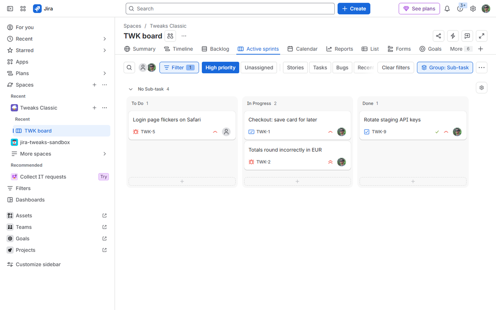

# Board Tweaks for Jira

A Chrome extension that makes Jira Cloud boards quicker to filter: your board's
quick filters become one-click toggle buttons instead of a dropdown, and the
board toolbar and search get out of the way.

 

## Features

- **Quick filters as buttons.** Every filter from the board's *Custom filters*
  dropdown shows up as a button you can toggle with one click. Selected ones are
  highlighted, and they stay in sync with Jira when you change filters another
  way (the dropdown, *Clear filters*, the back button, a shared link).
- **Separators.** Name a quick filter `|` or `—` and it's drawn as a divider,
  so you can group related filters.
- **One line or wrapped.** Keep the buttons on one line and scroll sideways
  (mouse wheel works), or let them wrap.
- **Compact search.** *Search board* shrinks to an icon until you click it.
- **Compact toolbar.** The board's icon buttons (Sprint details, View
  settings, …) move into the ••• menu.
- **Adjustable text size** for the buttons.

Everything can be switched on and off from the extension's popup. It works with
any Jira language.

## Requirements

- Jira Cloud (sites on `*.atlassian.net`).
- A board with quick filters. These are set up in *Board settings → Custom
  filters* on **company-managed** boards; team-managed boards don't have them,
  so there the extension only applies the toolbar and search tweaks.

## Install

- **Chrome Web Store:** *coming soon*.
- **From source:** download or clone this repository, open
  `chrome://extensions`, turn on *Developer mode*, click *Load unpacked* and
  choose the repository folder.

## Privacy

The extension runs only on `*.atlassian.net` pages and doesn't collect or send
any data. See [PRIVACY.md](PRIVACY.md).

## Bugs and feature requests

Please [open an issue](https://github.com/metalurgus/board-tweaks-for-jira/issues/new/choose).
Jira changes its interface often, so if something stops working, a report with
a screenshot of your board's toolbar helps a lot.

## Support

If the extension saves you time, you can support its development:

- **Ko-fi** (card or PayPal, from anywhere): *link coming soon*
- **monobank jar** (handy from Ukraine): *link coming soon*

## License

[MIT](LICENSE).

*Not affiliated with or endorsed by Atlassian. Jira is a trademark of
Atlassian.*
