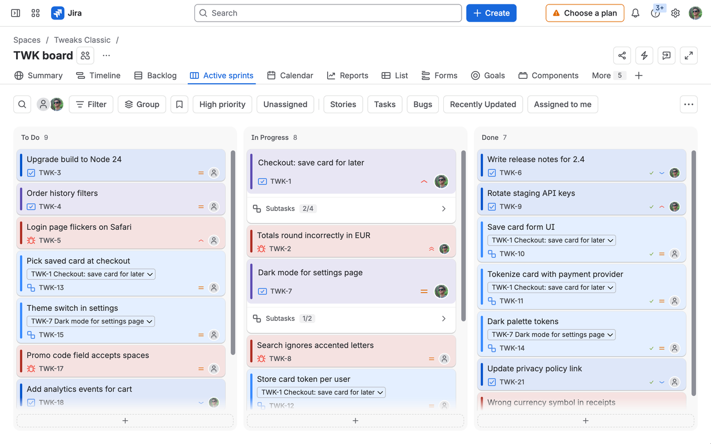

# Board Tweaks for Jira

A Chrome extension that makes Jira Cloud boards quicker to filter and fits more
of the board on screen: your board's quick filters sit on one line in the
toolbar, saved filter sets apply in one click, and the toolbar, search and
cards get out of the way.

 

## Features

- **One line of filters.** The board's filters sit in the toolbar on a single
  line and scroll sideways (mouse wheel works), instead of wrapping over
  several rows above the board. Or let them wrap.
- **Quick filters as buttons.** Jira shows a board's filters either in a
  *Custom filters* dropdown or as a line of its own buttons, depending on
  *Show custom filters individually* in the board's *View settings*. With the
  dropdown, every filter shows up as a button you can toggle with one click.
  Selected ones are highlighted, and they stay in sync with Jira when you
  change filters another way (the dropdown, *Clear filters*, the back button,
  a shared link). With Jira's own line, the extension keeps Jira's buttons and
  applies the one-line, separator and text-size tweaks to them.
- **Saved filter sets.** Save a combination of filters and apply it in one
  click, from the bookmark button next to the filters. Kept per board.
- **Number keys.** Optionally, <kbd>1</kbd>–<kbd>9</kbd> toggle the first nine
  filters and <kbd>0</kbd> clears them all.
- **Separators.** Name a quick filter `|` or `—` and it's drawn as a divider,
  so you can group related filters.
- **Compact search.** *Search board* shrinks to an icon until you click it.
- **Compact toolbar.** The board's icon buttons (Sprint details, View
  settings, …) move into the ••• menu.
- **Compact cards.** Less padding, titles up to two lines and smaller avatars,
  so about a third more cards fit on screen.
- **Column width.** Set an exact width for the columns: narrower so more fit
  without scrolling sideways (Jira never goes below 200px), or wider for long
  titles. *Auto* keeps Jira's own sizing.
- **Card colours.** Tint the whole card with its card colour, not just the
  thin stripe.
- **Adjustable text size** for the buttons.

Everything can be switched on and off from the extension's popup. It works with
any Jira language. See [CHANGELOG.md](CHANGELOG.md) for what changed in each
version.

## Requirements

- Jira Cloud (sites on `*.atlassian.net`).
- A board with quick filters. These are set up in *Board settings → Custom
  filters* on **company-managed** boards; team-managed boards don't have them,
  so there the extension only applies the toolbar and search tweaks.

## Install

- **Chrome Web Store:** [Board Tweaks for Jira](https://chromewebstore.google.com/detail/board-tweaks-for-jira/lclpdkflnpanakdcopkkafkdlklegaoh)
  (recommended; updates install automatically).
- **From source:** download or clone this repository, open
  `chrome://extensions`, turn on *Developer mode*, click *Load unpacked* and
  choose the repository folder.

## Privacy

The extension runs only on `*.atlassian.net` pages and doesn't collect or send
any data. See [PRIVACY.md](PRIVACY.md).

## Bugs and feature requests

Please [open an issue](https://github.com/metalurgus/board-tweaks-for-jira/issues/new/choose).
Jira changes its interface often, so if something stops working, a report with
a screenshot of your board's toolbar helps a lot.

## Support

If the extension saves you time, you can support its development through
the [monobank jar](https://send.monobank.ua/jar/AQ7QMzsSpt).

## License

[MIT](LICENSE).

*Not affiliated with or endorsed by Atlassian. Jira is a trademark of
Atlassian.*
